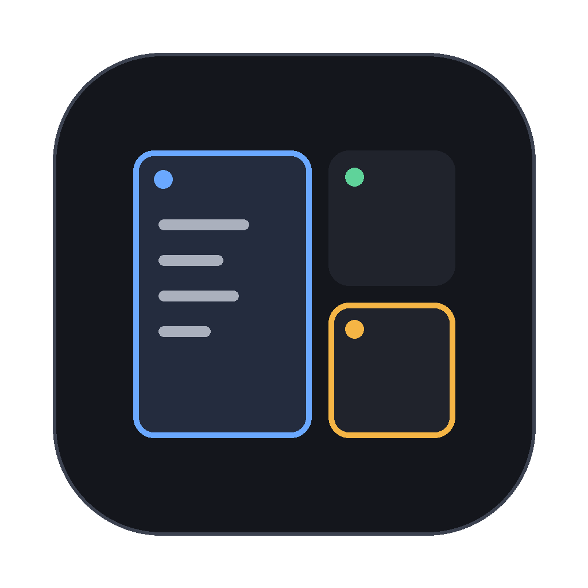
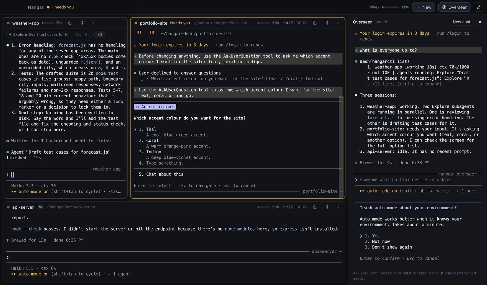

<p align="center">
  
</p>

<h1 align="center">Hangar</h1>

<p align="center">
  A calm, fullscreen home for your Claude Code sessions.<br>
  See every project at once, know which one needs you, and keep an eye on tokens and agents.
</p>

<p align="center">
  <a href="https://github.com/robberttorfs/hangar-releases/releases/latest/download/Hangar-mac-arm64.dmg"><b>Mac (Apple silicon)</b></a> ·
  <a href="https://github.com/robberttorfs/hangar-releases/releases/latest/download/Hangar-mac-x64.dmg"><b>Mac (Intel)</b></a> ·
  <a href="https://github.com/robberttorfs/hangar-releases/releases/latest/download/Hangar-windows-x64-setup.exe"><b>Windows</b></a> ·
  <a href="https://github.com/robberttorfs/hangar-releases/releases/latest/download/Hangar-windows-arm64-setup.exe">Windows on ARM</a>
</p>



## What it does

- **Real Claude Code, side by side.** Every tile is a full `claude` terminal. Nothing is reimplemented, so everything you know still works.
- **Tiles that size themselves.** A session that needs you grows and glows amber. The one you're typing in gets a little more room. Quiet ones shrink. Pin one to keep it big on the left.
- **Know who needs you.** A coloured dot and label on every tile: *Working*, *Needs you*, *Done*, *Idle*. The top bar counts them, and a notification arrives when a session waits on you or finishes something long.
- **Agents you can see.** When Claude starts subagents, each one shows up as a chip under the tile header with its job, how long it has run and how many tokens it used.
- **Live token counters.** Context used (with a bar), output tokens including agents, estimated cost, and your plan's 5-hour and weekly usage in the top bar.
- **Time budgets.** Give a session 30 minutes and Claude plans to fit: it gets a short note at the start, a "start wrapping up" note at 80% and a "finish now" note at the end, so it lands near the time with work that holds up.
- **The overseer.** A side panel with its own small Claude that can see all your sessions. Ask "anything waiting on me?" or "tell the portfolio session to use teal" and it checks, answers, or types the reply for you.

## Install

You need [Claude Code](https://code.claude.com) installed and logged in. Check that `claude` works in a normal terminal first.

### Mac

1. Download the `.dmg` for your Mac (Apple silicon for M1 and newer, Intel otherwise).
2. Open it and drag **Hangar** into **Applications**.
3. Hangar isn't notarised by Apple yet, so the first launch needs one extra step. Open Terminal and run:
   ```sh
   xattr -cr /Applications/Hangar.app
   ```
   Then open Hangar normally. (Alternatively: right-click Hangar, choose **Open**, then **Open** again.)
4. Allow notifications when asked.

### Windows

1. Download `Hangar-windows-x64-setup.exe` (or the ARM one for Snapdragon laptops).
2. Run it. Windows SmartScreen may say it doesn't recognise the app: click **More info**, then **Run anyway**.
3. Pick a folder or keep the default, and finish the installer.

Claude Code on Windows must be runnable as `claude` from PowerShell.

## Using it

**Start a session.** Drop a project folder anywhere on the window, press <kbd>⌘N</kbd> (<kbd>Ctrl+Shift+N</kbd> on Windows), or click a recent project. Click **Continue** on a recent project to pick up its last conversation instead of starting fresh.

**Work in it.** Click a tile and type, exactly like a terminal. Drag files onto a tile to paste their paths. <kbd>Shift+Enter</kbd> adds a new line.

**Arrange.** Drag a tile by its header onto another to swap places. Click the pin to make a session the main one. Double-click a name to rename it.

**Time budget.** Click the clock on a tile, pick 10 to 90 minutes or type your own. If Claude is already working it starts now; otherwise it starts with your next prompt. The clock turns amber at 80% and red when time is up. Nothing is ever killed; Claude is just told to wrap up.

**Overseer.** Click **Overseer** (<kbd>⇧⌘O</kbd>). Ask anything about your sessions in plain words. It only types into a session when you ask it to, and it checks the screen first so a permission menu gets a number, not a sentence. **New chat** starts it fresh.

**Closing.** Quitting Hangar stops the sessions, and they resume where they were the next time you open it.

### Shortcuts

| Action | Mac | Windows |
|---|---|---|
| New session | <kbd>⌘N</kbd> | <kbd>Ctrl+Shift+N</kbd> |
| Jump to session 1 to 9 | <kbd>⌘1</kbd> … <kbd>⌘9</kbd> | <kbd>Ctrl+1</kbd> … <kbd>Ctrl+9</kbd> |
| Next session that needs you | <kbd>⇧⌘U</kbd> | <kbd>Ctrl+Shift+U</kbd> |
| Pin focused session | <kbd>⇧⌘P</kbd> | <kbd>Ctrl+Shift+P</kbd> |
| Time budget for focused session | <kbd>⌘T</kbd> | <kbd>Ctrl+Shift+T</kbd> |
| Overseer | <kbd>⇧⌘O</kbd> | <kbd>Ctrl+Shift+O</kbd> |
| Bigger / smaller text | <kbd>⌘=</kbd> / <kbd>⌘-</kbd> | <kbd>Ctrl+=</kbd> / <kbd>Ctrl+-</kbd> |
| Fullscreen | <kbd>⌃⌘F</kbd> | <kbd>F11</kbd> |
| Copy / paste in a tile | <kbd>⌘C</kbd> / <kbd>⌘V</kbd> | <kbd>Ctrl+Shift+C</kbd> / <kbd>Ctrl+Shift+V</kbd> |

The sliders icon in the top bar sets which notifications you get, the context and usage warning levels, and the overseer's model.

## Token use

Hangar is built to cost you nothing extra.

- **Sessions get no added context.** Hangar listens through Claude Code hooks that reply with nothing, so the model never sees them. The only exception is a time budget you set yourself: that adds a few one-line notes over the whole task.
- **Counters are read locally** from Claude Code's statusline and transcript files. They make no API calls.
- **The overseer is lean.** It runs Sonnet with only one tool and no MCP servers, plugins or skills, so each question starts from about 6k tokens of context instead of the usual 60k or more. It reads a one-line-per-session summary first and only opens a session's messages or screen when your question needs them. When you aren't asking it anything, it uses nothing.

## Privacy

Everything stays on your computer. Sessions are ordinary `claude` processes using your own login. Hangar talks to them over `127.0.0.1` with a random key per launch. It doesn't change your global Claude Code settings: each session gets its hooks through a separate settings file.

## Troubleshooting

- **"claude was not found".** Hangar starts `claude` through your login shell (PowerShell on Windows), so it sees the same PATH as your terminal. Make sure `claude --version` works there, then press **Restart** on the tile.
- **A tile says *Needs you* but nothing seems to be asked.** Claude Code is showing a menu or tip at the bottom of that terminal. Answer it or press <kbd>Esc</kbd>.
- **No 5-hour or weekly gauge.** Those numbers only exist for claude.ai Pro, Max and Ultra plans, and appear after the first reply.
- **Mac says the app is damaged.** Run the `xattr -cr` command from the install steps.

## Uninstall

- **Mac:** delete Hangar from Applications, and optionally `~/Library/Application Support/Hangar`.
- **Windows:** uninstall from Settings → Apps, and optionally delete `%APPDATA%\Hangar`.

Your Claude Code sessions and history are untouched; they live in Claude Code's own folder as always.
